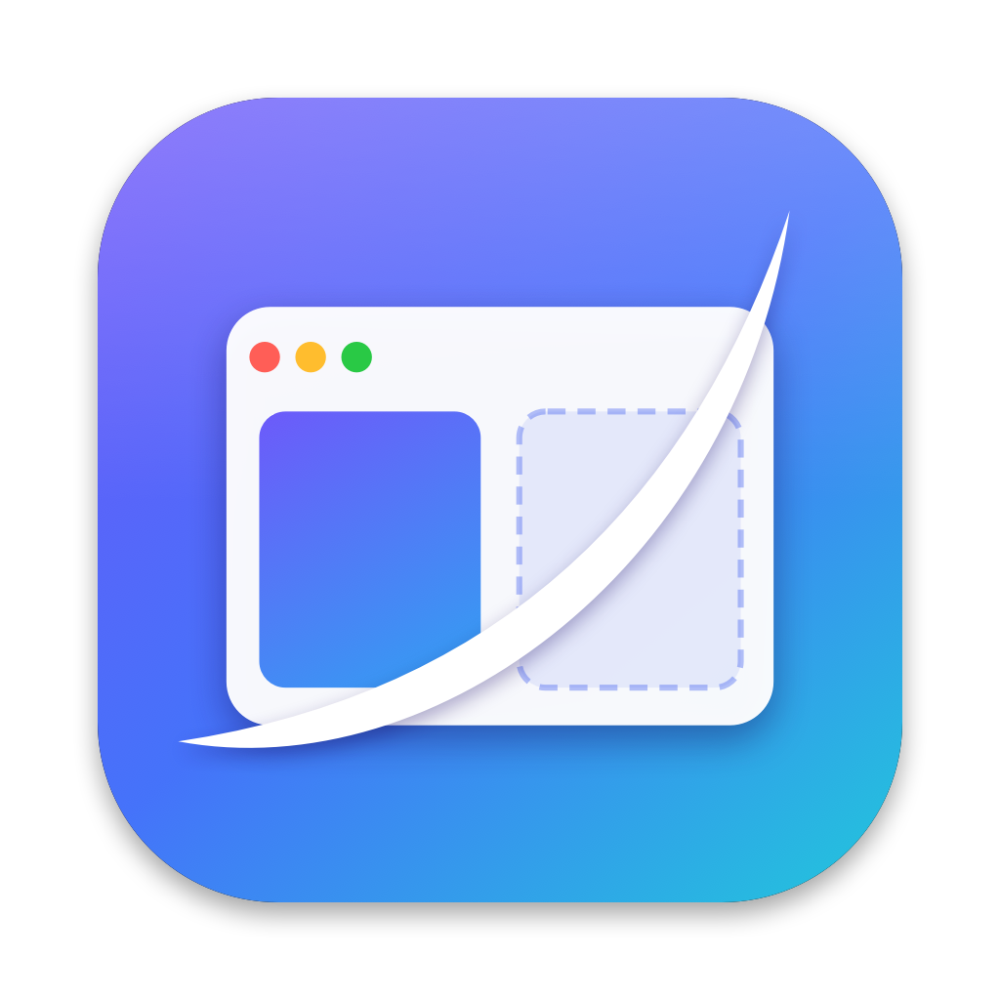

# Swoosh



Trackpad gestures and keyboard shortcuts for window management on macOS.
Swipe, pinch or double tap on a window's title bar to snap, maximize, minimize,
close or move it. Written from scratch based on how Swish works (see
[docs/REVERSE_ENGINEERING.md](docs/REVERSE_ENGINEERING.md)).

## Build, test and run

```sh
./build.sh --run          # runs the tests, builds build/Swoosh.app and opens it
./build.sh --install      # also copies it to /Applications
swift test                # tests only
```

Requires macOS 13+ and the Swift toolchain (Command Line Tools is enough).
On first launch, Swoosh opens its **Setup** tab, which checks:

- **Accessibility** access
- *Zoom in or out*, needed for pinch
- *Smart zoom*, needed for double tap

The app is ad-hoc signed, so macOS treats each rebuild as a new app. Turn the
Accessibility permission off and on again after rebuilding, or set
`SWOOSH_SIGN_IDENTITY` to a real signing identity.

**Quit Swish before using Swoosh.** Both apps capture the same gestures.

## Gestures (pointer over a title bar)

| Gesture | Result |
|---|---|
| Swipe ← / → | Left / right half |
| Swipe again the same way | Third → two thirds → half |
| From a third, swipe the other way | Move through the thirds |
| Half, then ↑ / ↓ (or ↑ / ↓, then sideways) | Quarter |
| Third, then ↑ / ↓ | Sixth (3×2) or ninth (3×3, set in Settings) |
| Swipe ↑ | Maximize (again: almost maximize) |
| Swipe ↓ | Minimize (one swipe, from any unsnapped or maximized window) |
| Pinch in / ⌥ pinch in | Close window / quit app |
| Pinch out | Enter or exit full screen |
| Double tap | Unsnap or center |
| ⌃ + swipe | Move to the screen in that direction |
| Swipe ↓ / ↑ on the menu bar | Minimize / restore all windows on that screen |

Swipes chain: change direction mid-swipe, or swipe again straight away without
moving the pointer. Sliders and scroll areas in toolbars, such as Music's
volume slider, keep their normal scrolling.

## Keyboard shortcuts

Set the keys under Settings › Keyboard: Arrow keys (the default), WASD, IJKL or Off.

| Shortcut | Result |
|---|---|
| ⌃⌥ + direction | One snap step on the frontmost window (chains like swipes) |
| ⌃⌥⌘ + direction | Move to the screen in that direction |
| ⌃⌥C | Unsnap or center |

## Other settings

- Gap between windows, or "Match macOS tiling margins"
- Space reserved for the Stage Manager strip, used automatically when Stage Manager is on
- Swipe distance, haptics, preview, title-bar hot zone, chaining time
- Launch at login and excluded apps

## Code map

- `Sources/SwooshCore`: pure logic, fully unit tested
  - `Layout.swift`: snap rectangles and the swipe grammar
  - `SwipeSession.swift`: turns scroll deltas into steps and outcomes
  - `Geometry.swift`: screen maths (detection, mapping, restore, Stage Manager)
  - `Policy.swift`: title-bar hit policy, chaining, hotkey layouts, trackpad checks
- `Sources/Swoosh`: the AppKit app
  - `GestureEngine.swift`: CGEventTap for scroll, pinch and smart zoom
  - `WindowManager.swift`: Accessibility window actions
  - `Hotkeys.swift`: global shortcuts (Carbon)
  - `Overlay.swift`, `StatusIcon.swift`, `SettingsView.swift`, `main.swift`: UI
- `Tests/SwooshCoreTests`: Swift Testing suite
- `Scripts/make-icon.swift`: renders `Resources/AppIcon.icns`

To review the settings UI without Screen Recording permission, run
`build/Swoosh.app/Contents/MacOS/Swoosh --render-settings <dir>`. It writes a
PNG of every tab in light and dark mode.
